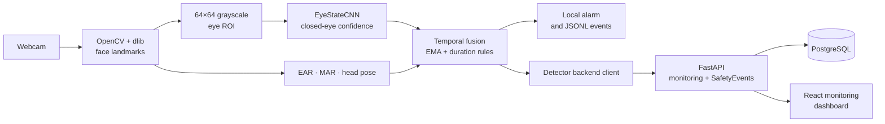

# Subject-Independent Real-Time Driver Drowsiness Detection System

> A real-time driver-safety system that combines facial landmarks, CNN-based state classification, temporal decision rules, and a FastAPI monitoring backend.

**Huỳnh Thị Ngọc Hoài — ML Engineer & Backend Integration**

**Core stack:** Python · TensorFlow/Keras · OpenCV · dlib · FastAPI · PostgreSQL · React

## Project Overview

Fixed EAR/MAR thresholds often degrade across different faces, eyewear, camera angles, and lighting conditions. This project evaluates whether a learned eye/mouth-state classifier generalizes better than geometric thresholding, then turns that model into an end-to-end real-time monitoring system.

The runtime detects facial landmarks, extracts normalized `64 × 64` grayscale eye regions, combines CNN predictions with geometric and temporal signals, and emits an alert only when evidence persists. Confirmed events are published to a FastAPI backend for trip monitoring, alert management, safety scoring, and dashboard visualization.

## My Role and Contributions

My primary ownership in this team project covered the ML pipeline and the integration boundary between the detector and backend:

- **Dataset and training:** collected subject-varied samples, cleaned labels, designed augmentation, and trained the three-class `EyeStateCNN` model (`closed`, `open`, `yawn`).
- **Real-time computer vision:** integrated dlib facial landmarks, CNN inference, EAR/MAR fallback logic, head-pose estimation, and camera overlays.
- **Temporal alerting:** added EMA smoothing, consecutive-frame rules, event-duration checks, cooldowns, and warning-to-critical escalation to reduce transient false alarms.
- **Backend integration:** connected the detector to FastAPI for live snapshots, camera frames, settings, and AI `SafetyEvent` ingestion with queued retries.
- **Safety workflow:** linked ML events to active trips, persisted alerts, generated safety scores, and supplied live monitoring data to the dashboard.
- **Evaluation:** compared the CNN with an EAR/MAR baseline using subject-independent macro-F1, paired McNemar testing, and subject-cluster bootstrap intervals.

## System Architecture



The camera-facing runtime remains local for low-latency inference. Only monitoring state, frames, and structured safety events are sent to the backend.

## Technical Foundations

### 1. Facial landmarks and region extraction

dlib's 68-point facial-landmark model locates the eye corners, eyelids, mouth contour, nose, and jaw. These landmarks provide geometry for EAR/MAR and stable eye regions for CNN inference. Each selected eye region is converted to grayscale and resized to `64 × 64`, reducing input cost while retaining the shape and texture needed to distinguish open and closed eyes. Mouth landmarks provide the separate MAR yawning signal.

### 2. Eye and mouth aspect ratios

Both Eye Aspect Ratio (EAR) and Mouth Aspect Ratio (MAR) compare two vertical distances with one horizontal distance:

```math
\mathrm{Ratio} = \frac{A + B}{2C}
```

`A` and `B` measure vertical opening, while `C` measures horizontal width. EAR falls when the eyelids close; MAR rises when the mouth opens. The runtime uses EAR as a fallback when the CNN is unavailable and uses MAR as an additional yawning signal. A ratio must remain beyond its threshold for consecutive frames before it becomes an event.

### 3. CNN state classification

`EyeStateCNN` uses convolution blocks with `32`, `64`, and `128` filters to learn local edges, eyelid contours, and higher-level appearance patterns. Max pooling reduces spatial dimensions, Batch Normalization stabilizes optimization, and Dropout limits overfitting. A dense layer and Softmax output probabilities for `closed`, `open`, and `yawn`. Training uses Adam with categorical cross-entropy.

Data augmentation applies rotation, translation, zoom, horizontal flips, and brightness variation. These transformations simulate head movement, camera placement, and illumination changes without altering the semantic class.

### 4. Head-pose estimation

Selected 2D landmarks are matched with a generic 3D face model through OpenCV `solvePnP`. The resulting rotation is converted into pitch, yaw, and roll. Instead of relying only on an absolute camera angle, the runtime calibrates a personal pitch baseline and detects a significant downward deviation, making head-nod detection less sensitive to camera placement.

### 5. Temporal decision logic

Single-frame predictions are noisy and ordinary blinks must not trigger a drowsiness alarm. The runtime smooths CNN confidence with an exponential moving average and combines it with consecutive-frame counters and duration rules. Eye closure must persist for at least two seconds before a drowsiness event is emitted; state transitions also prevent the same continuous episode from being published repeatedly.

### 6. Subject-independent evaluation

A random image split can leak a person's facial identity into both training and testing data. Subject-independent cross-validation keeps every subject entirely inside one fold, providing a more realistic measure of generalization to unseen drivers.

- **Macro-F1** gives each class equal importance, even when class frequencies differ.
- **McNemar's test** compares paired CNN and EAR/MAR errors on the same samples.
- **Subject-cluster bootstrap** resamples complete subjects rather than individual images, preserving within-person dependence when estimating the confidence interval.

## Reported Experimental Results

The reported study used a self-collected dataset of **2,951 images from 8 subjects**, including variation in lighting, head pose, and eyewear.

| Evaluation | Method | Result |
|---|---|---:|
| 5-fold subject-independent CV | CNN with cleaning and augmentation | **93.8 ± 1.7% macro-F1** |
| 5-fold subject-independent CV | EAR/MAR threshold baseline | **81.3% macro-F1** |
| Cross-dataset evaluation | CNN on YawDD | **84.5% macro-F1** |
| Laptop CPU inference | Intel Core i5-1135G7 | **30 FPS** |

- Cleaning and augmentation improved CNN macro-F1 from `90.6%` to `93.8%` (**+3.2 percentage points**).
- The reported paired comparison gives **McNemar `p < 0.001`** and a **95% subject-cluster bootstrap CI of `[+9.0, +16.0]` percentage points** for the CNN improvement over EAR/MAR.

### Reproducibility status

The trained model and evaluation utilities are included, but the subject-labeled dataset and paired out-of-fold prediction CSV are not committed to this repository. The values above are therefore presented as **reported experimental results**, not as metrics that can be regenerated from the repository alone.

When paired predictions are available, [`evaluate_models.py`](./evaluate_models.py) computes macro-F1, exact McNemar statistics, and a subject-cluster bootstrap interval. Detailed model inspection and runtime measurements are documented in [`model_evaluation_report.md`](./model_evaluation_report.md).

## Quick Start

### Prerequisites

- Python with a TensorFlow-compatible environment
- Node.js and npm
- PostgreSQL
- Git LFS for the model assets

### 1. Install dependencies

```bash
git clone https://github.com/ngochoai0810/project-team-internship.git
cd project-team-internship
git lfs pull

python -m venv .venv
source .venv/bin/activate
pip install tensorflow -r requirements.txt -r backend/requirements.txt

cd frontend
npm install
cd ..
```

### 2. Configure and start the backend

Create a PostgreSQL database, copy [`backend/.env.example`](./backend/.env.example) to `backend/.env`, and set the database credentials and JWT secret.

```bash
cp backend/.env.example backend/.env
python -m backend.db.schema init
python -m uvicorn backend.app:app --reload
```

API documentation is available at `http://127.0.0.1:8000/docs`.

### 3. Start the dashboard

```bash
cd frontend
cp .env.example .env
npm run dev
```

### 4. Run the detector

From the repository root:

```bash
python integrate_cnn.py \
  --camera 1 \
  --model best_model_v2.h5 \
  --class-json class_indices_v2.json \
  --publish-safety-events-backend \
  --safety-backend-url http://127.0.0.1:8000/api/v1 \
  --safety-backend-token <access-token>
```

Without backend event publishing, the compatibility launcher can be run as:

```bash
python integrate_cnn.py --camera 1 --model best_model_v2.h5 --class-json class_indices_v2.json
```

## Project Map

| Path | Responsibility |
|---|---|
| [`smart_collect.py`](./smart_collect.py) | Guided subject-varied image collection and augmentation |
| [`train_cnn.py`](./train_cnn.py) | CNN training, validation, and model export |
| [`integrate_cnn.py`](./integrate_cnn.py) | Compatibility entrypoint for the detector |
| [`integrate_cnn_with_events.py`](./integrate_cnn_with_events.py) | Real-time CV/ML runtime and event generation |
| [`detector_backend.py`](./detector_backend.py) | Reliable detector-to-API publishing client |
| [`backend/`](./backend/) | FastAPI services, authentication, repositories, and trip safety logic |
| [`frontend/`](./frontend/) | React/Vite monitoring and fleet dashboard |
| [`database/drowsiness_safety_db_schema.sql`](./database/drowsiness_safety_db_schema.sql) | Canonical PostgreSQL schema |

## Known Limitations

- Very low light, strong eyeglass reflections, face occlusion, and partial yawns can reduce reliability.
- Head-pose accuracy depends on visible landmarks and an appropriate calibration period.
- The current benchmark covers a limited number of subjects; broader demographic and cross-camera validation is still needed.
- This project is a research and portfolio prototype, not a certified automotive safety or medical device.

## Acknowledgements

This repository is a team internship project. The contribution summary above describes my primary ML engineering and backend-integration scope; other team members contributed to the broader application.

The original facial-landmark drowsiness-detector foundation was derived from the open-source [Driver Drowsiness Detector](https://github.com/msindev/Driver-Drowsiness-Detector) project and was substantially extended with CNN training, temporal event logic, backend services, persistence, and a monitoring dashboard.
